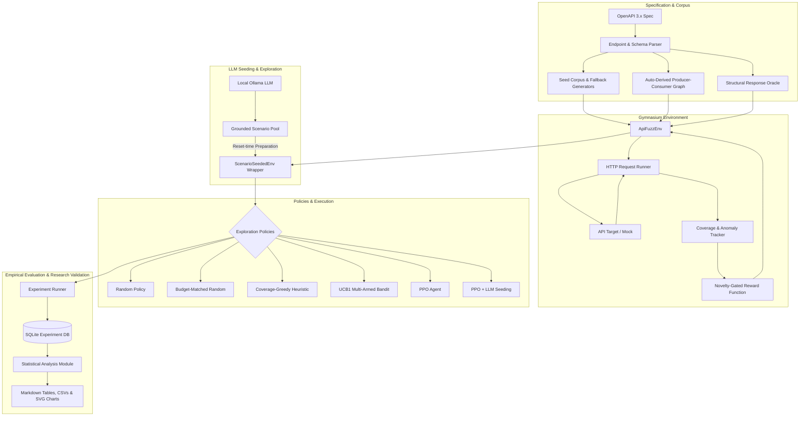

# api-rl-fuzzer: Autonomous RL-Based API Fuzzing with Intelligent Baselines & Grounded LLM Seeding

An autonomous, coverage-guided reinforcement learning (RL) API fuzzer designed for RESTful web APIs described by OpenAPI 3.x specifications.

The system combines:
1. **Automated OpenAPI Ingestion & Structural Invariants** (no manual rules)
2. **Auto-Derived Producer-Consumer Dependency Graphs** (enabling multi-step call chains)
3. **Novelty-Gated Coverage & Structural Oracle Rewards** (preventing reward hacking)
4. **Proximal Policy Optimization (PPO)** on a standard Gymnasium interface
5. **Strictly-Local Grounded LLM Scenario Seeding** (for diverse warm-up states at reset time)
6. **Empirical Research Evaluation Framework**:
   - 6 comparative policies (`random`, `random_budget_matched`, `greedy`, `bandit`, `ppo`, `ppo_llm`)
   - 2 multi-resource benchmark targets with reachable ground-truth planted bugs
   - Seed-paired evaluation schedules and rigorous multi-stage request accounting
   - Non-parametric statistical tests (Vargha-Delaney $\hat{A}_{12}$, Mann-Whitney U, Wilcoxon, Bootstrap 95% CIs)

---

## Architecture Overview



---

## Phase Breakdown

### Phase 1: Spec Parsing, Dependency Graph & Structural Oracle
- `src/spec/parser.py`: Ingests OpenAPI 3.x specifications into typed `Endpoint` and `Field` primitives, extracting path/query/header parameters, request bodies, and status-keyed response schemas.
- `src/spec/graph.py`: Automatically derives a producer $\to$ consumer dependency graph by matching response field names/types to input parameter names/types (exact and suffix matching, e.g. `id` matches `orderId`). Unresolvable relationships are exported without fabrication.
- `src/spec/oracle.py`: Structural response oracle evaluating status-code validity, required field presence, and datatype conformance against spec declarations.

### Phase 2: Seed Corpus & Value Generation
- `src/corpus/seed_dict.py`: Builds a seed corpus from spec `example`/`enum` declarations and optional real recording logs (`sample_inputs.json`).
- `src/corpus/fallback_generator.py`: Schema-aware fallback generator producing valid RFC-compliant datatypes (UUID, email, date-time, regex, bounded numerics).
- `src/corpus/resolver.py`: Dynamically arbitrates between seed corpus values, producer dependency values, and generative fallbacks via configurable probability annealing.

### Phase 3: Coverage-Guided Gymnasium Environment
- `src/env/api_env.py`: Full `gymnasium.Env` compliant environment (`ApiFuzzEnv`) exposing discrete endpoint action spaces and normalized observation vectors.
- `src/env/coverage.py`: Tracks distinct `(operation, status)` coverage states and raw request volumes.
- `src/env/reward.py`: Novelty-gated reward function paying bonuses only for novel per-episode coverage and genuinely distinct anomaly signatures, eliminating reward-hacking loops.
- `src/executor/request_runner.py`: Rate-limited, budget-capped HTTP transport executor.

### Phase 4: Reinforcement Learning via PPO
- `src/agent/train_ppo.py`: Integrates Stable-Baselines3 PPO directly against `ApiFuzzEnv`. PPO observes endpoint coverage progress and learns multi-step calling sequences to optimize cumulative coverage and anomaly discovery.

### Phase 5: Grounded Local LLM Scenario Seeding
- `src/brainstormer/`: Local Ollama integration (`qwen2.5:7b` / `mistral`) that generates edge-case invocation scenarios based on spec structure, corpus values, and uncovered endpoints.
- `src/brainstormer/grounding.py`: Strict schema grounding verifying that every scenario operation exists in the spec and conforms to parameter constraints.
- `src/env/scenario_seeding.py`: `ScenarioSeededEnv` wrapper executing valid scenarios exclusively during `reset()` to initialize target and environment state. PPO retains 100% control over all action steps during episodes.

### Phase 6: Empirical Research Validation & Evaluation Framework
- **Intelligent Baselines**:
  - `Random`: Standard uniform random fuzzer over $N_{\text{episodes}}$.
  - `Random (Budget-Matched)`: Random fuzzer executed until matching PPO's exact total request budget ($B_{\text{target}} = \text{timesteps} + N_{\text{episodes}} \times \text{max\_steps}$, default 11,000 requests), ensuring fair comparisons against training overhead.
  - `Coverage-Greedy`: Heuristic baseline prioritizing unvisited endpoints in the current observation vector, falling back to historically least-hit endpoints.
  - `UCB1 Multi-Armed Bandit`: Upper Confidence Bound online policy balancing empirical reward exploitation and logarithmic exploration.
  - `PPO`: Reinforcement learning agent trained on coverage and novelty rewards.
  - `PPO + LLM`: PPO trained with grounded LLM reset-time scenario preparation.
- **Experimental Fairness**:
  - **Paired Evaluation Seeds**: All policies evaluate on identical deterministic seed sequences (`EVALUATION_SEED_OFFSET = 10_000`, seed = `trial_seed + 10000 + ep_num`), ensuring exact side-by-side comparability across trials.
  - **Multi-Stage Request Accounting**: Explicitly records training timesteps ($B_{\text{train}}$), warm-up preparation requests ($B_{\text{prep}}$), evaluation requests ($B_{\text{eval}}$), and grand total requests ($B_{\text{total}}$).
  - **Ground-Truth Bug Discovery**: Measures discovery against planted reachable bugs with undeclared status codes (`COUNT(DISTINCT bug_name)`), separating true bugs from structural anomalies and false positives.
  - **Multi-Target Generalization**: Validated on two distinct APIs:
    1. *Orders API* (`tests/fixtures/sample_api.yaml`): 3 operations (`createOrder`, `getOrder`, `cancelOrder`), 3 planted bugs.
    2. *E-Commerce API* (`tests/fixtures/ecommerce_api.yaml`): 6 operations across 4 resources (`createUser`, `getUser`, `createCart`, `addItemToCart`, `checkoutCart`, `payOrder`), multi-step dependency chain ($A \to B \to C \to D$), 3 planted bugs.
- **Statistical Significance**:
  - `src/experiment/analysis.py`: Computes Vargha-Delaney $\hat{A}_{12}$ non-parametric effect sizes, Mann-Whitney U test p-values, paired Wilcoxon signed-rank test p-values, and 95% bootstrap confidence intervals ($B=2000$).

---

## Target Benchmark APIs & Planted Bugs

| Target Spec | Resource Chain | Planted Bug Key | Trigger Condition | Status Code | Ground-Truth Type |
| :--- | :--- | :--- | :--- | :---: | :--- |
| `sample_api.yaml` | Orders | `bug_getorder_malformed_id` | `GET /orders/<malformed-id>` | 400 | Single-step unseeded call |
| `sample_api.yaml` | Orders | `bug_cancelorder_double` | `POST /orders/<id>` on cancelled order | 409 | Multi-step sequence dependency |
| `sample_api.yaml` | Orders | `bug_createorder_big_qty` | `POST /orders` with quantity > 9000 | 422 | Value-dependent boundary |
| `ecommerce_api.yaml` | Users $\to$ Carts $\to$ Orders | `bug_ecommerce_invalid_user_id` | `GET /users/<malformed-id>` | 400 | Single-step malformed ID |
| `ecommerce_api.yaml` | Users $\to$ Carts $\to$ Orders | `bug_ecommerce_double_checkout` | `POST /carts/<id>/checkout` twice | 409 | Stateful sequence dependency |
| `ecommerce_api.yaml` | Users $\to$ Carts $\to$ Orders | `bug_ecommerce_oversized_item_qty` | `POST /carts/<id>/items` with qty > 9000 | 422 | Value-dependent inventory limit |

---

## Measured Benchmark Findings

Full benchmark runs were executed across 5 random seeds (42–46) on both benchmark targets.

> [!NOTE]
> **PPO+LLM Benchmark Status:** `ppo_llm` was **not evaluated** in the full benchmark because the local Ollama instance (`http://localhost:11434`) had no model downloaded (`[]` returned from `/api/tags`). Its reset-time preparation, schema grounding, and prompt generation are fully validated and tested via mocked LLM unit tests (`tests/test_phase5_brainstormer.py` and `tests/test_phase6_planted_bug_pipeline.py`).

### Target 1: Orders API (`runs/benchmark_orders_full.db`)

| Policy | Mean Reward +/- Std | Ops Covered | Coverage States | Planted Bugs Found | False Positives | Eval Steps to 1st Bug | Total Reqs to 1st Bug | Total Requests (Train / Eval) |
| :--- | :---: | :---: | :---: | :---: | :---: | :---: | :---: | :---: |
| **`ppo`** | **13.780 +/- 0.179** | 3.00 +/- 0.00 | 6.0 +/- 0.0 | **3.00 +/- 0.00** | 1.00 +/- 0.00 | **1.0 +/- 0.0** | 10,241.0 | 11,240 (10,240 / 1,000) |
| **`greedy`** | 11.970 +/- 0.325 | 3.00 +/- 0.00 | 7.0 +/- 0.0 | **3.00 +/- 0.00** | 1.00 +/- 0.00 | 3.4 +/- 3.8 | **3.4** | 1,000 (0 / 1,000) |
| **`random_budget_matched`** | 11.681 +/- 0.274 | 3.00 +/- 0.00 | 7.0 +/- 0.0 | **3.00 +/- 0.00** | 1.00 +/- 0.00 | 3.6 +/- 4.7 | 3.6 | 11,000 (0 / 11,000) |
| **`random`** | 11.610 +/- 0.577 | 3.00 +/- 0.00 | 7.0 +/- 0.0 | **3.00 +/- 0.00** | 1.00 +/- 0.00 | 3.6 +/- 4.7 | 3.6 | 1,000 (0 / 1,000) |
| **`bandit`** | 10.980 +/- 0.722 | 3.00 +/- 0.00 | 7.0 +/- 0.0 | **3.00 +/- 0.00** | 1.00 +/- 0.00 | 2.4 +/- 1.8 | **2.4** | 1,000 (0 / 1,000) |

- **Observation**: On a small action space (3 endpoints), PPO learned the optimal sequence, attaining the highest mean episode reward and finding bugs on **step 1** of every evaluation episode.

### Target 2: E-Commerce API (`runs/benchmark_ecommerce_full.db`)

| Policy | Mean Reward +/- Std | Ops Covered | Coverage States | Planted Bugs Found | False Positives | Eval Steps to 1st Bug | Total Reqs to 1st Bug | Total Requests (Train / Eval) |
| :--- | :---: | :---: | :---: | :---: | :---: | :---: | :---: | :---: |
| **`greedy`** | **19.740 +/- 0.928** | **6.00 +/- 0.00** | **13.0 +/- 0.0** | **3.00 +/- 0.00** | 4.00 +/- 0.00 | 12.4 +/- 7.2 | **12.4** | 1,000 (0 / 1,000) |
| **`bandit`** | **19.610 +/- 0.728** | **6.00 +/- 0.00** | **13.0 +/- 0.0** | **3.00 +/- 0.00** | 4.00 +/- 0.00 | **8.8 +/- 3.0** | **8.8** | 1,000 (0 / 1,000) |
| **`random_budget_matched`** | 19.212 +/- 0.164 | **6.00 +/- 0.00** | **13.0 +/- 0.0** | **3.00 +/- 0.00** | 4.00 +/- 0.00 | 33.0 +/- 29.3 | 33.0 | 11,000 (0 / 11,000) |
| **`random`** | 18.640 +/- 0.462 | **6.00 +/- 0.00** | **13.0 +/- 0.0** | **3.00 +/- 0.00** | 4.00 +/- 0.00 | 33.0 +/- 29.3 | 33.0 | 1,000 (0 / 1,000) |
| **`ppo`** | 9.800 +/- 3.701 | 3.80 +/- 1.30 | 3.8 +/- 1.3 | 0.20 +/- 0.45 | 2.80 +/- 0.84 | 2.0 (1 trial) | 10,242.0 | 11,240 (10,240 / 1,000) |

- **Observation**: On deep multi-resource dependency chains, the UCB1 Bandit reached the first planted bug in **8.8 steps** and Coverage-Greedy in **12.4 steps**, nearly **4x faster than Random** (33.0 steps). Standard PPO without warm-up scenario seeding experienced exploration starvation on the 6-operation multi-step chain under 10k timesteps, illustrating the importance of guided scenario seeding.

---

## Directory Layout

```
api-rl-fuzzer/
├── config/
│   └── target.yaml                 # live target configuration template
├── src/
│   ├── spec/
│   │   ├── parser.py               # OpenAPI 3.x schema parser
│   │   ├── graph.py                # Producer-consumer dependency graph
│   │   └── oracle.py               # Structural schema oracle
│   ├── corpus/
│   │   ├── seed_dict.py            # Spec example & recording corpus
│   │   ├── fallback_generator.py   # Type-aware fallback generator
│   │   └── resolver.py             # Seed-or-generator value resolver
│   ├── executor/
│   │   ├── config.py               # Target configuration loader
│   │   ├── request_runner.py       # Budget/rate-limited HTTP runner
│   │   ├── mock_target.py          # Stateful in-memory Orders mock
│   │   ├── planted_bugs.py         # Orders API ground-truth planted bugs
│   │   └── mock_ecommerce_target.py# Stateful in-memory E-Commerce mock & bugs
│   ├── env/
│   │   ├── coverage.py             # (op, status) and signature tracker
│   │   ├── reward.py               # Novelty-gated reward formulation
│   │   ├── action_space.py         # Action space resolution
│   │   ├── api_env.py              # Core ApiFuzzEnv Gymnasium environment
│   │   └── scenario_seeding.py     # ScenarioSeededEnv reset-time wrapper
│   ├── agent/
│   │   ├── __init__.py             # Exports baselines & policies
│   │   ├── random_policy.py        # Random uniform policy
│   │   ├── greedy_policy.py        # Coverage-greedy heuristic policy
│   │   ├── bandit_policy.py        # UCB1 multi-armed bandit policy
│   │   └── train_ppo.py            # PPO training & environment builder
│   ├── brainstormer/
│   │   ├── scenarios.py            # Pydantic scenario schemas
│   │   ├── hardware.py             # Auto-detects local Ollama tier
│   │   ├── llm_client.py           # Strictly-local Ollama HTTP client
│   │   ├── grounding.py            # Spec-grounding validator
│   │   ├── context.py              # LLM context & prompt builder
│   │   └── pool.py                 # Scenario queue & brainstorm cadence
│   └── experiment/
│       ├── tracker.py              # SQLite schema & persistence layer
│       ├── metrics.py              # Multi-trial policy aggregation
│       ├── runner.py               # End-to-end benchmark orchestrator
│       └── analysis.py             # Statistical tests (A12, U, Wilcoxon, CI)
├── results/
│   ├── orders_summary.md           # Orders API statistical report
│   ├── ecommerce_summary.md        # E-Commerce API statistical report
│   ├── orders_metrics.csv          # Raw per-trial metrics CSV (Orders)
│   ├── ecommerce_metrics.csv       # Raw per-trial metrics CSV (E-Commerce)
│   ├── benchmark_report.md         # Comprehensive cross-benchmark report
│   ├── orders_reward_chart.svg     # SVG reward comparison (Orders)
│   ├── ecommerce_reward_chart.svg  # SVG reward comparison (E-Commerce)
│   └── discovery_speed_chart.svg   # SVG discovery speed comparison
├── tests/
│   ├── test_phase1_spec.py         # Spec parser & graph tests
│   ├── test_phase2_corpus.py       # Seed corpus & generator tests
│   ├── test_phase3_env.py          # Gymnasium env & reward novelty tests
│   ├── test_phase4_train_ppo.py    # PPO training loop tests
│   ├── test_phase5_brainstormer.py # LLM grounding & seeding tests
│   ├── test_phase6_experiments.py  # SQLite tracking & metrics tests
│   ├── test_phase6_planted_bug_pipeline.py # Seed pairing & accounting tests
│   ├── test_baselines.py           # Greedy, Bandit, Budget-Matched tests
│   ├── test_ecommerce_target.py    # E-Commerce benchmark & bug tests
│   ├── test_statistical_analysis.py# Non-parametric stats & report tests
│   └── fixtures/
│       ├── sample_api.yaml         # Orders OpenAPI spec
│       ├── sample_inputs.json      # Sample input recordings
│       └── ecommerce_api.yaml      # E-Commerce OpenAPI spec
├── pyproject.toml
└── README.md
```

---

## Setup & Installation

### Requirements
- Python 3.10+ (tested on Python 3.12)
- Windows / Linux / macOS
- Local Ollama instance (optional; only required for `ppo_llm` live brainstorming)

### Environment Setup
```powershell
# Create virtual environment
python -m venv .venv

# Activate virtual environment
.\.venv\Scripts\Activate.ps1   # Windows PowerShell
# source .venv/bin/activate    # Linux / macOS

# Install dependencies in editable mode
pip install -e .
```

---

## Replication & Demo Walkthrough

### 1. Run Complete Automated Regression Test Suite
Run all 132 tests across all 6 phases:
```powershell
pytest tests/ -v
```

### 2. Fast Multi-Policy Comparison (Dry-Run Demo)
Evaluate `random`, `greedy`, and `bandit` on the Orders API with reachable planted bugs and statistical reporting:
```powershell
python src/experiment/runner.py --policies random greedy bandit --n-trials 3 --n-episodes 10 --max-steps 20 --use-planted-bugs --analyze
```

### 3. Evaluate the Second Benchmark API (E-Commerce Target)
Run intelligent exploration policies against the multi-resource E-Commerce API:
```powershell
python src/experiment/runner.py --spec tests/fixtures/ecommerce_api.yaml --policies random greedy bandit --n-trials 3 --n-episodes 10 --max-steps 20 --use-planted-bugs --analyze
```

### 4. Full Benchmark Execution (All 6 Policies with PPO & LLM)
Run the full comparative study across all policies:
```powershell
# Ensure Ollama is running with model pulled if evaluating ppo_llm:
# ollama serve
# ollama pull qwen2.5:7b

python src/experiment/runner.py --policies random random_budget_matched greedy bandit ppo ppo_llm --n-trials 5 --n-episodes 20 --max-steps 50 --timesteps 10000 --use-planted-bugs --analyze
```

### 5. Generate Statistical Analysis from Existing Database
Re-analyze and generate Markdown tables from an existing SQLite run:
```powershell
python src/experiment/runner.py --summarize-only --db-path runs/benchmark_orders_full.db --analyze
```

---

## Statistical Methodology

All empirical comparisons adhere to standard empirical software engineering principles:
1. **Vargha-Delaney $\hat{A}_{12}$ Effect Size**:
   $$\hat{A}_{12} = \frac{\sum_{i=1}^{n_1} \sum_{j=1}^{n_2} I(X_i > Y_j) + 0.5 \cdot I(X_i = Y_j)}{n_1 \cdot n_2}$$
   - Quantifies the probability that a trial from Policy A yields higher coverage/bug discovery than Policy B.
   - Classification: $\hat{A}_{12} \ge 0.71$ denotes a **large** effect size.
2. **Mann-Whitney U Test**: Two-tailed non-parametric test assessing whether two independent metric distributions differ significantly.
3. **Wilcoxon Signed-Rank Test**: Evaluates paired trials that executed under identical evaluation seed schedules.
4. **95% Bootstrap Confidence Intervals**: Computed using $B = 2,000$ bootstrap resamples with replacement for differences in means.

---

## Limitations

1. **Stateful Mock vs Real Database Resets**: The built-in mock transports support instantaneous `reset_state()`. Live production APIs require transactional isolation or container reset fixtures.
2. **Discrete Endpoint Action Spaces**: Actions select operations; parameters are dynamically resolved via corpus and producer-consumer chains. Per-field mutation as a distinct RL action level remains future work.
3. **LLM Inference Latency**: Local LLM scenario generation adds inference time during periodic brainstorm intervals; cold-start mitigation is addressed by caching grounded scenarios in the scenario pool.
